# Rd. Note サポート

**道を、コレクションしよう。**

Rd. Note は、走った道を記録して、気持ちよく流れた道を「あなたの名道」として集めていくドライブの帳面です。どの道を名道として残すか(Sweet Flow)は、あなたが選びます。記録はすべて端末の中に残ります。

## 自動で記録を始める(オートメーション) {#automation}

iPhone の「ショートカット」アプリのオートメーションを使うと、CarPlay につないだときに記録が始まり、外したときに止まります。アプリを開かずに始めるには、位置情報を「常に」にしておいてください(設定 → プライバシーとセキュリティ → 位置情報サービス → Rd. Note)。

作るオートメーションは2つです。

| CarPlay が | 動かすアクション |
|---|---|
| 接続されたとき | Rd. Note の「記録を始める」 |
| 接続解除されたとき | Rd. Note の「記録を終わらせる」 |

iOS のバージョンで手順が違います。お使いの iPhone の版は、設定 → 一般 → 情報 →「iOS バージョン」で確かめられます。

- [iOS 27 の手順](#automation-ios27)
- [iOS 26 の手順](#automation-ios26)

### iOS 27 の手順 {#automation-ios27}

iOS 27 では「オートメーション」タブがなくなり、ショートカットを作る画面でトリガー(きっかけ)を足す形になりました。

**1. 「すべてのショートカット」の ＋ を押す**

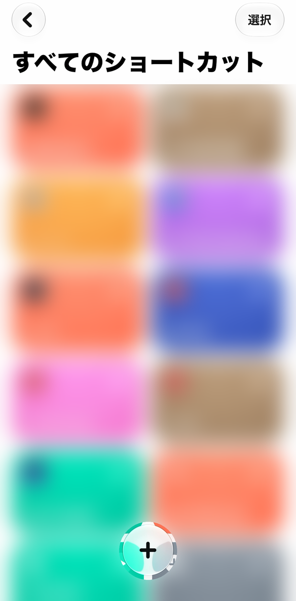{: width="280" style="border:1px solid #c9ced6;border-radius:18px"}

**2. 右上の「編集」を押し、下に出る一覧の上にある「オートメーション」を選ぶ**

はじめは「ショートカットでどのような操作を実行しますか?」と、言葉で説明する画面が開きます。ここには何も書かずに「編集」を押します。

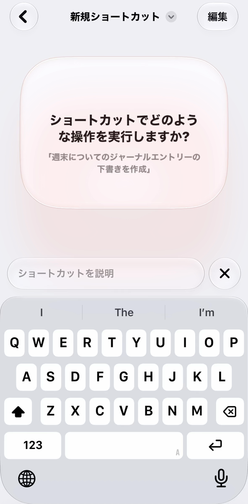{: width="280" style="border:1px solid #c9ced6;border-radius:18px"}
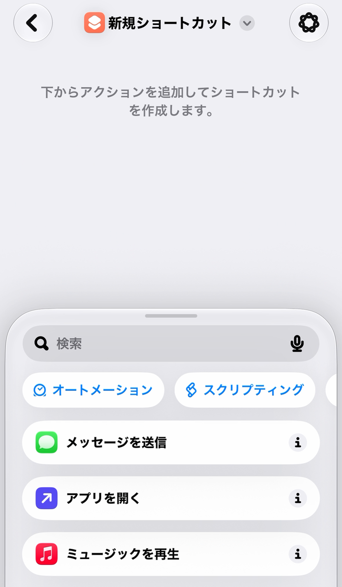{: width="280" style="border:1px solid #c9ced6;border-radius:18px"}

**3. 「接続」の中の「CarPlay」を選ぶ**

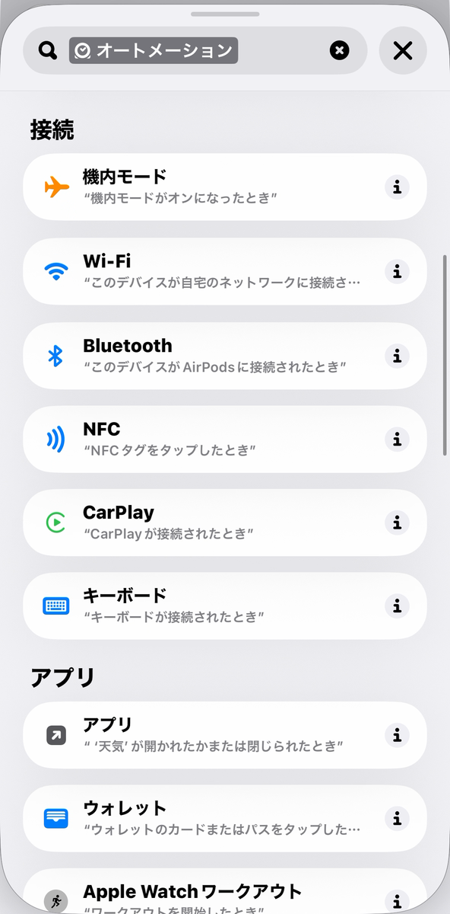{: width="280" style="border:1px solid #c9ced6;border-radius:18px"}

**4. 「CarPlay が 接続されている とき」になっていることを確かめる**

青い言葉を押すと「接続されている」「接続解除されている」「接続または接続解除されている」から選べます。記録を始めるほうは「接続されている」のままにします。

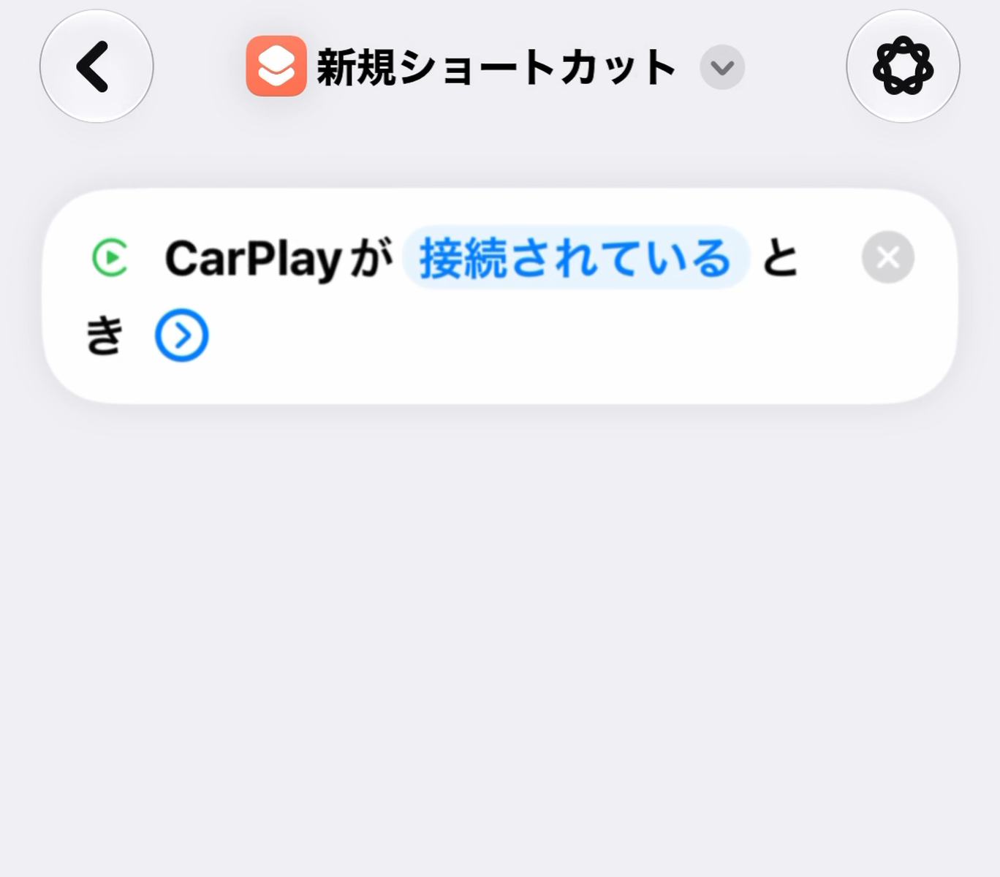{: width="280" style="border:1px solid #c9ced6;border-radius:18px"}
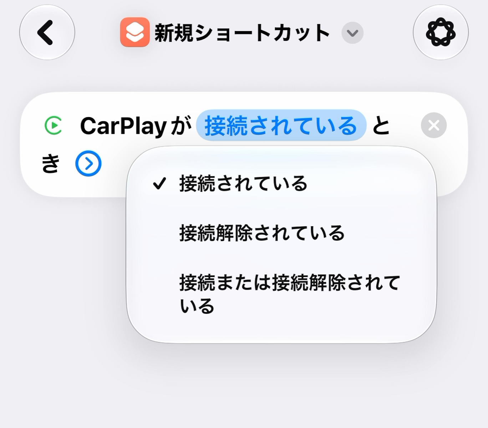{: width="280" style="border:1px solid #c9ced6;border-radius:18px"}

右の ⌄ を開くと、「オートメーション」のスイッチがあります。**オンのままにしてください。** オンだと、つなぐたびに確認せずに動きます。「通知」は、動いたことを知らせてほしいときだけオンにします。

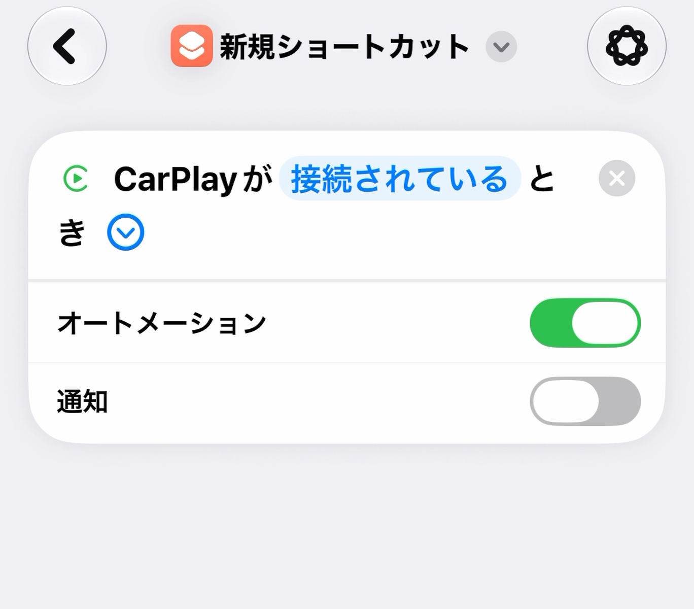{: width="280" style="border:1px solid #c9ced6;border-radius:18px"}

**5. 下の検索で「Rd. Note」を探し、「記録を始める」を足す**

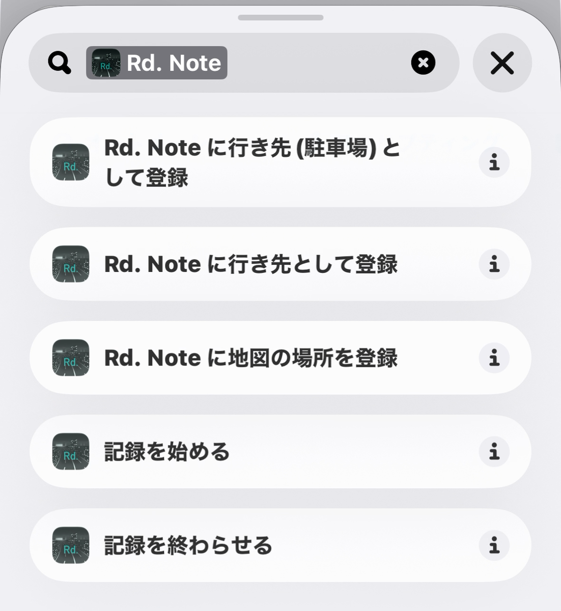{: width="280" style="border:1px solid #c9ced6;border-radius:18px"}

足したアクションには「実行時に表示」のスイッチがあります。オンだと「Rd. Note で記録を始めました。」と表示されます。表示がいらなければオフにしてください。

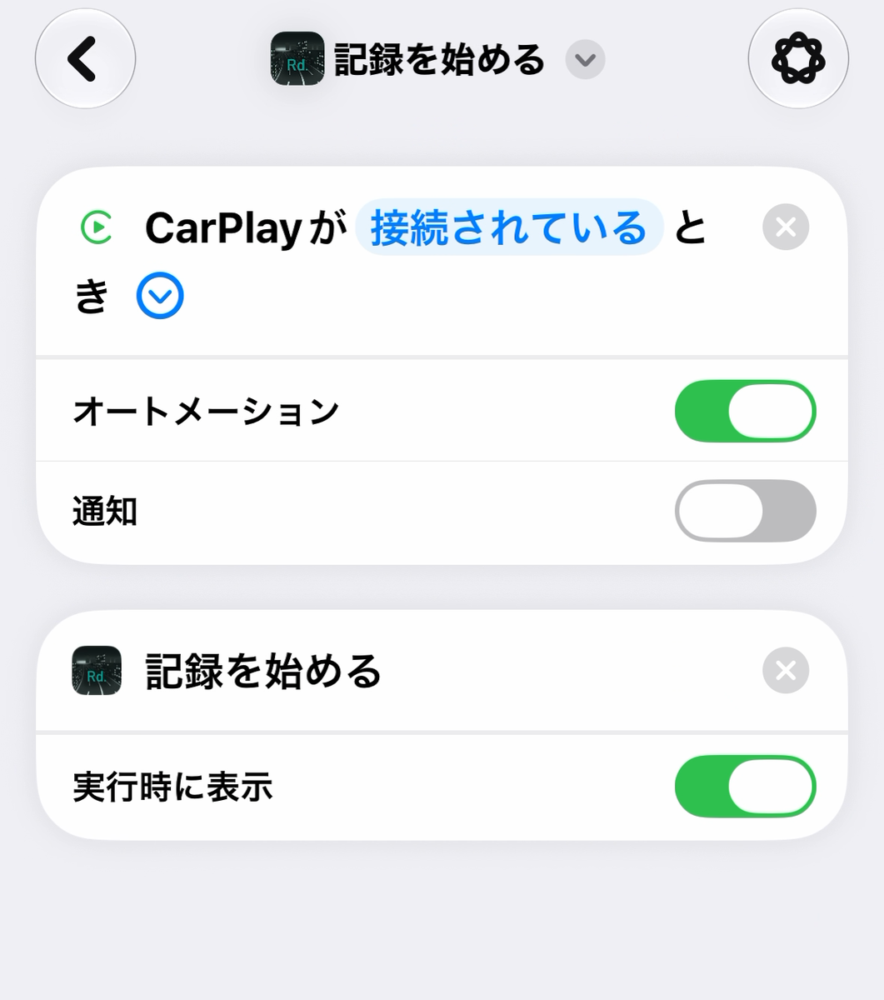{: width="280" style="border:1px solid #c9ced6;border-radius:18px"}

**6. 名前を確かめて、左上の ＜ で戻る**

アクションを足すと、ショートカットの名前は「記録を始める」に変わります。別の名前にしたいときは、上の名前を押して変えます。

**7. 同じ手順で、もう1つ作る**

手順 4 で「接続解除されている」を選び、手順 5 で「記録を終わらせる」を足します。名前は「記録を終わらせる」になります。

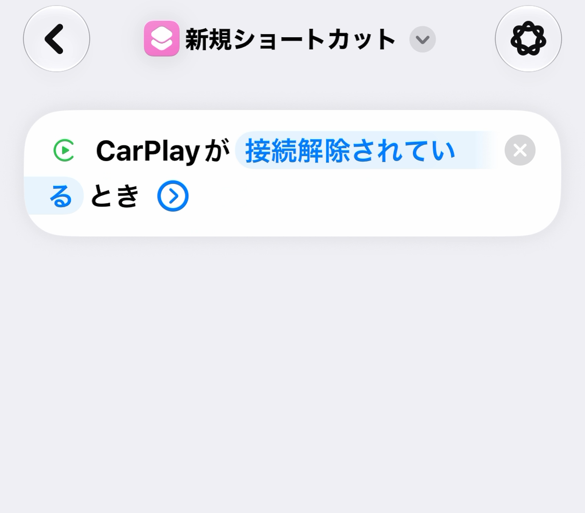{: width="280" style="border:1px solid #c9ced6;border-radius:18px"}
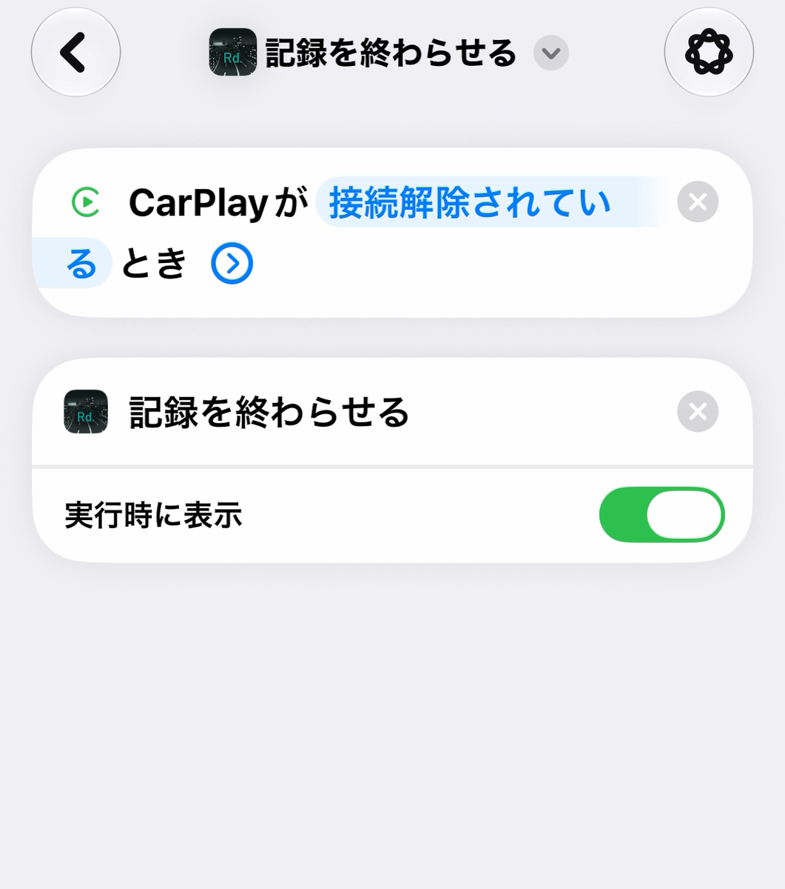{: width="280" style="border:1px solid #c9ced6;border-radius:18px"}

### iOS 26 の手順 {#automation-ios26}

**1. 下の「オートメーション」タブを開き、「新規オートメーション」を押す**

すでにオートメーションがあるときは、右上の ＋ を押します。

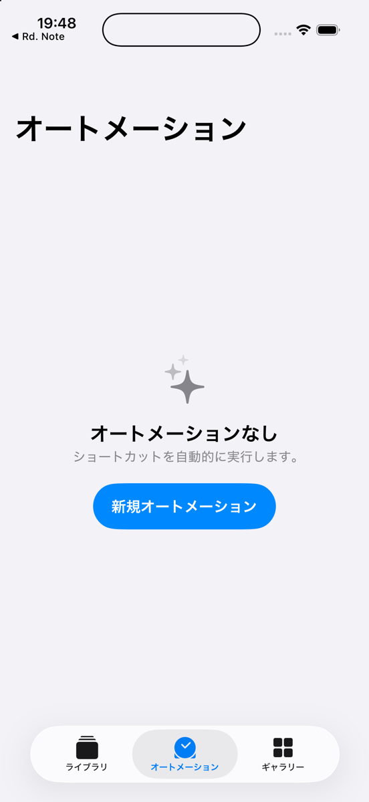{: width="280" style="border:1px solid #c9ced6;border-radius:18px"}

**2. 一覧から「CarPlay」を選ぶ**

トリガー(きっかけ)の一覧から「CarPlay」を探して選びます。

**3. 「接続」を選び、その下で「すぐに実行」を選んで「次へ」を押す**

「確認後に実行」のままだと、つなぐたびに確認が出て、押すまで記録が始まりません。「実行時に通知」は、動いたことを知らせてほしいときだけオンにします。

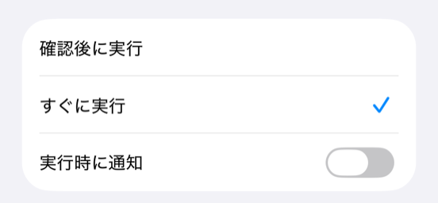{: width="280" style="border:1px solid #c9ced6;border-radius:18px"}

**4. アプリの一覧から Rd. Note を開き、「記録を始める」を選ぶ**

選ぶとその場で保存され、一覧に戻ります。

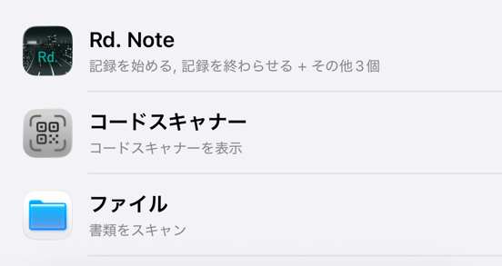{: width="280" style="border:1px solid #c9ced6;border-radius:18px"}
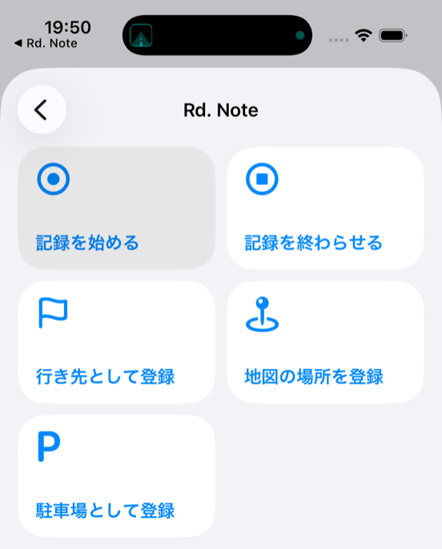{: width="280" style="border:1px solid #c9ced6;border-radius:18px"}

**5. 同じ手順で、もう1つ作る**

手順 3 で「接続解除」を選び、手順 4 で「記録を終わらせる」を選びます。

### うまく動かないとき

- **記録が始まらない:** 位置情報が「常に」になっているか確かめてください。「使用中のみ」だと、アプリを開くよう求められます。
- **「Rd. Note: 無料で残せる50走行に達しているので…」と出る:** 無料で残せる走行の数に達しています。アプリの設定 →「走行の保存」をご覧ください。
- **CarPlay を使っていない:** オートメーションを使わなくても、アプリのドライブ画面の「記録をはじめる」から記録できます。

## よくある質問

**自動で記録が始まりません。**
設定 → プライバシーとセキュリティ → 位置情報サービス → Rd. Note を「常に」にしてください。CarPlay につないだときに自動で始める方法は、上の「自動で記録を始める」をご覧ください。

**地図データは必要ですか。**
無くても、記録・気持ちよさの表示・Sweet Flow は使えます。地図データを入れると、走行後に走った道路を名前つきで当てはめます。設定 → 地図データから、地方ごとに入れられます(156〜685MB)。

**機種変更のときは。**
端末のバックアップから復元すると、記録も引き継がれます。設定 →「データをすべて書き出す」で、ファイルとして手元に残すこともできます。

**データを消したい。**
設定 →「すべてのデータを消す」で消せます。消したデータは戻せません。

## お問い合わせ

winniecraftapp@icloud.com

## プライバシーポリシー

https://winniecraftsoftware.github.io/rdnote-map-data/privacy.html
